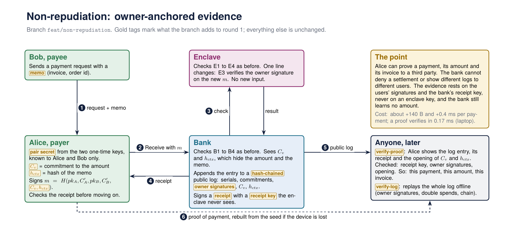

# Non-repudiation: owner-anchored evidence

Status: implemented on branch `feat/non-repudiation`, submitted for validation (not yet agreed with the advisors; not on `main`).

[PDF](evidence-flow.pdf) · [source](evidence-flow.tex)

## The point

In round 1 a payment is private and correct, but nobody can prove it afterwards: not that it happened, not its amount, not what it paid for. This branch lets a payer prove a payment, its amount and its invoice to a third party, and stops the bank from denying a settlement or showing different logs to different users. The evidence rests on the users' own signatures and on a bank receipt key; it never rests on an enclave key, and the bank still learns no amount.

## How it works

1. **The request carries a memo.** The payee's request includes a memo, for example an invoice number.
2. **The signed payment commits to the amount and the memo.** Payer and payee derive a pair secret from their two one-time keys. From it, the payer builds `C_v`, a commitment to the amount, and `h_ctx`, a hash of the memo, and signs `m = H(pk_A, C_A', pk_B, C_B', C_v, h_ctx)`. Only the two of them can open `C_v` and `h_ctx`.
3. **The enclave is unchanged** except that E3 verifies the owner signature on this new `m`. It receives no new input.
4. **The bank keeps public evidence.** Each log entry now holds the owner signatures, `C_v` and `h_ctx`, and is chained to the previous entry by hash. The bank signs a receipt for every entry with a receipt key the enclave never sees; both wallets check it before moving to their next state.
5. **Anyone can audit the log.** `tv-bank verify-log` replays it offline: owner signatures, double spends, chain and receipts.
6. **Proofs of payment.** `tv-cli prove-payment` shows the entry, its receipt and the opening of `C_v` and `h_ctx`; `tv-cli verify-proof` checks them. Modes: payer, payee, amount only, and a proof designated to one verifier. A wallet restored from its seed rebuilds its proofs.

## Cost and limits

- About +140 B and +0.4 ms per payment; receipt signing 0.011 ms; verifying a proof 0.17 ms; a Pay log line doubles (laptop, `docs/BENCH.md`, "Evidence layer").
- The payee can now prove the amount of a payment to anyone, by design. A designated proof hides who presents it, not the amount: deniable proofs remain an open question.
- Not built: fetching the log from the bank (`verify-log --from-bank`) and a pinned log head (`--log-head`).
