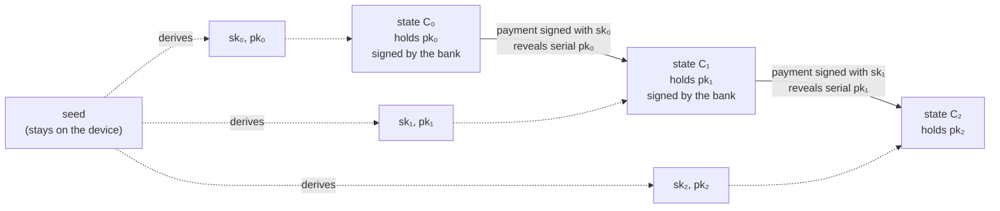
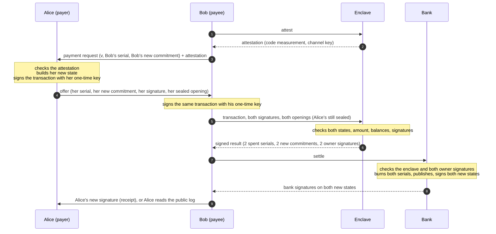

# Round 1: Platypus with a TEE in place of the zero-knowledge proofs

**Status:** submitted for advisor validation (2026-11-09). Builds on [SCOPE.md](../SCOPE.md) and [FOUNDATIONS.md](../FOUNDATIONS.md).

| Design | Behaviour | Analysis |
|---|---|---|
| [1. Goal](#1-goal-stay-as-close-to-platypus-as-possible) | [5. A payment](#5-a-payment) | [9. If the enclave's memory is read](#9-if-the-enclaves-memory-is-read) |
| [2. In one paragraph](#2-the-system-in-one-paragraph) | [6. Who checks what](#6-who-checks-what) | [10. What the bank learns](#10-what-the-bank-learns) |
| [3. Setting and trust](#3-setting-and-trust) | [7. Other operations](#7-other-operations) | [11. Differences from Platypus](#11-differences-from-platypus) |
| [4. State and ownership](#4-state-and-the-chain-of-ownership) | [8. Crashes](#8-when-the-enclave-crashes) | [12. Possible solutions for balance](#12-possible-solutions-for-balance-integrity) |
| [Overview map](#overview-map) | [Appendix A: messages](#appendix-a-messages) | [Appendix B: notation](#appendix-b-notation) |

The [payment map](maps/payment.pdf) and the [overview map](maps/overview.pdf) are also available as PDF.

## 1. Goal: stay as close to Platypus as possible

Round 1 stays **as close to Platypus as possible**. The aim is to isolate a single change, replacing the two zero-knowledge proofs of a Platypus transaction with one call to a TEE run by the bank, so that its effect on cost, privacy and trust can be measured on its own.

Everything else is Platypus:
- the same user-held state;
- the same joint transaction between payer and payee;
- the same spent-serial check at the bank;
- the same public transaction log;
- the same issuance through the bank's own account;
- the same abort by an empty update.

> **On top of the replacement, round 1 makes one adjustment required by the foundation: no user secret that can spend funds is ever sent to the enclave.**
>
> **The version presented on 2026-11-03 gave the enclave the user's serial and blinding keys.** This version makes each serial a one-time public key and has the owner sign each transaction. The enclave only ever sees signed transactions, never a key that can sign.

## 2. The system in one paragraph

Each user holds a **state** (a balance, a one-time public key that serves as the serial, and a blind) together with the bank's signature on a commitment to it. To pay, the payer and the payee agree on one joint transaction (both spent serials and both new commitments) and each **signs it with the one-time key of the state they spend**. The payee sends the enclave the transaction, both signatures, and both parties' openings; the payer's opening is sealed so the payee cannot read it. The enclave checks that both states are genuine, that the balances add up and that both owners signed, then outputs a signed result. The payee sends the result to the bank. The bank checks the enclave's signature and **both owners' signatures**, burns the two serials, publishes the transaction in the public log, and signs both new states. The bank never sees balances, amounts, or who pays whom.

## 3. Setting and trust

| Party | Integrity | Privacy | Failure |
|---|---|---|---|
| **Bank** | trusted: follows the protocol and signs only valid results | honest-but-curious: analyses everything it sees, may collude with users | does not lose its records |
| **TEE** (run by the bank) | runs the attested code correctly | protects what it processes | may crash; a fresh instance starts with empty memory |
| **Users** | untrusted: may double spend, replay old states or forge states | the protected party | keep their device |
| **Network** | none | anonymous: the bank cannot tell who sends a request | none |

**Assumptions:**
- The payee's payment request reaches the payer over an authenticated channel. Payee authentication is out of scope.
- The hand-off between payer and payee is confidential. It is needed for privacy only: an eavesdropper on the offer would learn the amount, but could not change or redirect the payment (section 5).
- For the analysis of section 9, the enclave's memory may also be read while its code keeps running correctly. Replacing its code is out of scope.

## 4. State and the chain of ownership

A state is `S = (b, pk, r)`:
- `b` is the balance;
- `pk` is a one-time public key, which also serves as the serial;
- `r` is a random blind. It keeps the commitment hiding once `pk` is revealed at spend: without it, the bank could hash every possible balance with the revealed `pk` until one matches a published commitment, which would reveal the balance and link the payment to the one that created the state.

The bank signs a commitment `C = Com(b, pk, r)` without learning its content. The commitment hides `S`, and the bank's signature `σ` makes it valid money.

Each user keeps one secret seed, which **never leaves the device**. The `i`-th signing key and blind are derived from it. Spending the state with key `pk_i` creates a new state carrying `pk_{i+1}`.

**Why this proves ownership without proving identity.**
- The first state carries `pk_0`, chosen by the user at enrollment.
- Every later key `pk_{i+1}` sits inside a state that the bank signed only after verifying a signature by `sk_i`.
- By induction, only the holder of the seed can spend the chain.

The keys change at every payment, and only the seed's owner can tell that they belong together. To the enclave and the bank, two keys from one chain are unrelated.

**Recovery.** The seed regenerates every key and blind. A user who loses the latest state finds it in the public log by walking the chain.

## 5. A payment

Alice pays `v` to Bob. As in Platypus, only the recipient talks to the system: Bob is the only one who contacts the enclave and the bank.

1. **Request.** Bob prepares his new state `C_B' = Com(b_B + v, pk_B⁺, r_B⁺)` and sends Alice the amount, his current serial `pk_B` and `C_B'`. He also relays the enclave's attestation, so Alice never contacts the bank's machine.
2. **Offer.** Alice checks the attestation. She builds `C_A' = Com(b_A − v, pk_A⁺, r_A⁺)` and signs the transaction `m = H(pk_A, C_A', pk_B, C_B')` with `sk_A`. She seals the opening of her current state and her next key and blind to the enclave, so Bob cannot read them, and hands Bob the offer.
3. **Receive.** Bob signs the same `m` with `sk_B`. He sends the enclave the transaction, both signatures, Alice's sealed opening and his own opening, over the attested encrypted channel, so the bank's machine sees only ciphertext.
4. **Check.** The enclave runs the checks of section 6 and returns one signed result.
5. **Settle.** Bob submits the result. The bank runs its checks, burns both serials together, appends the transaction to the public log, and signs both new states.
6. **Finish.** Bob forwards Alice's new signature. If he does not, Alice finds it in the public log under her old serial.

**The amount never appears in `m`.** The bank must be able to recompute `m` without learning `v`. That is not a loss: `C_A'` commits to `b_A − v` and `C_B'` to `b_B + v`, so the two signed commitments fix the amount, and the enclave checks it by opening both.

## 6. Who checks what

**The enclave** (it opens both states):

| # | Check | Prevents |
|---|---|---|
| E1 | both current states carry a valid bank signature | spending a state the bank never issued |
| E2 | `0 < v ≤ b_A` and `b_B + v ≤ B_max` | overspending, overflow |
| E3 | the new commitments open to `b_A − v` and `b_B + v` with the new keys and blinds | new states that do not match the amount |
| E4 | both owner signatures on `m` | someone else spending a state |

**The bank** (it sees only serials, commitments and signatures):

| # | Check | Prevents |
|---|---|---|
| B1 | the result is signed by a registered, attested enclave | results not checked by the attested code |
| B2 | it recomputes `m` and verifies Alice's signature under `pk_A` and Bob's under `pk_B` | theft, even if the enclave's memory is read |
| B3 | the two serials differ, neither was spent, both are burned together | double spending, and spending one state on both sides |
| B4 | it signs both new commitments, and a retried request gets the same answer | a lost or doubled payment after a crash |

## 7. Other operations

| Operation | What happens | What the bank learns |
|---|---|---|
| **Enroll** | The user creates a first state at balance 0 with `pk_0`. The enclave checks the balance is 0, and the bank signs it. | one new commitment |
| **Refresh** (abort) | Platypus's empty update: the owner signs a move of the same balance to a new key. This cancels an offer that was never received. A party whose serial was shown to the counterparty or to the bank in a payment that did not complete refreshes too, so no exposed serial stays in use. | one spent serial, one new commitment |
| **Issue and redeem** | As in Platypus, the bank holds a state for its own account and pays users through ordinary payments. Redeeming is a payment to the bank. | its own side and the amount, never the user |
| **Read the public log** | Anyone can read it or mirror it. A user finds the bank's signature on a new state under the old serial. | nothing, when read from a mirror |

## 8. When the enclave crashes

The enclave keeps nothing between requests, so a crash loses nothing:
- **Before the bank records the payment:** nothing happened. Bob resends to a fresh instance. Alice's opening was sealed to the old instance's key, so she reseals the same content for the new one. Her signature does not change, because `m` names no enclave.
- **After the result, before settlement:** Bob settles the result he already holds. The bank keeps the old instance's registered key valid long enough to accept it.
- **After the bank records it:** a retry of the same result gets the stored answer. There is never a second debit.
- **Deterministic results:** every new key and blind comes from the users, so the same input always gives the same result.
- **Replaying an old state:** its serial is spent, so the bank refuses it.
- **Total outage:** the bank's records, the users' states and the public log are enough to restart. A new enclave is attested and registered.

## 9. If the enclave's memory is read

Suppose an attacker can read everything the enclave holds or receives: the openings of the states, the channel key, and the enclave's signing key. The code itself still runs correctly.

| Property | Holds? | Why |
|---|---|---|
| **Ownership integrity:** nobody spends someone else's state | **yes** | Spending needs the owner's signature (B2). Signing keys never leave the devices; the enclave only sees signed transactions. |
| A payment cannot be redirected or changed | **yes** | The owner signs the exact new states (`m`). A replay finds the serial already spent (B3). |
| No double spend | **yes** | The bank's spent set (B3). |
| Nobody can burn another user's state | **yes** | Burning a serial also needs its owner's signature. |
| **Balance integrity:** no money created | **no** | The bank cannot see balances, so conservation is checked only by the enclave (E2, E3). With the enclave's signing key, an attacker can sign a result that inflates **its own** state. |
| Privacy of the payments processed | **no** | The attacker reads their amounts, balances and next keys. Each payment links to the participants' next one, through the next key. |

**Where this leaves integrity.** It is not yet fully decoupled from the TEE, but the dependence is now narrow:
- no user key is shared with the enclave, and ownership is enforced by the bank;
- only balance conservation still rests on the trust placed in the enclave's key;
- a leaked enclave key can create money for the attacker's own states, but cannot take money from anyone.

Section 12 lists the ways to close the gap.

## 10. What the bank learns

| Operation | Sees | Never sees |
|---|---|---|
| Payment | two spent serials, two new commitments, three signatures, the time | who pays or receives, the amount, any balance, the next serials |
| Refresh | one spent serial, one new commitment, the time | who, the balance |
| Enroll | one new commitment, the time | who, the first serial |

Each serial is a fresh key used once, so the bank cannot link two payments by the same user.

## 11. Differences from Platypus

| | Platypus | Round 1 |
|---|---|---|
| Validity of a transaction | two zero-knowledge proofs, one per party, bound by a transaction commitment | one enclave check of the whole transaction, and one signed result |
| Ownership of a state | proven inside the zero-knowledge proof | the owner signs with the serial's one-time key, and the bank verifies it |
| Payer's private data | hidden inside her proof | sealed to the attested enclave, so the payee cannot read it |
| Balance conservation | guaranteed by the proofs (mathematics) | guaranteed by the enclave's check and its key |
| Extra pieces needed by the TEE | none | attestation and enclave registration, resealing after a crash, deterministic results, idempotent settlement |
| State, serial check, public log, issuance, abort | as described in the paper | the same |

## 12. Possible solutions for balance integrity

**The goal:** the bank checks balance conservation itself, as it already checks ownership, while keeping Platypus's privacy. The bank cannot check values it does not see without some cryptographic proof, so a TEE alone cannot do it. The options, for discussion:

| Option | Balance rests on | The bank sees who pays whom | Amounts hidden | Role of the TEE | Cost |
|---|---|---|---|---|---|
| **Zero-knowledge proofs as in Platypus** | mathematics | no | yes | computes the proofs for weak devices; a break leaks what it saw | one proof per party per payment |
| **Additive commitments with range proofs** | mathematics | yes | yes | not needed for integrity | small proofs, cheap checks |
| **The same, with the TEE batching payments** | mathematics | only which batch | yes | hides who pays whom inside a batch; a break reveals that pairing | batch rounds, all participants online |
| **The enclave attests every result** | the TEE vendor and correct code | no | yes | as in round 1 | one attestation per payment |

## Overview map

## Appendix A: messages

| Message | From → to | Content |
|---|---|---|
| Attestation | enclave → Bob → Alice | code measurement, channel key, freshness nonce. The enclave's signing key is registered with the bank separately, at boot. |
| Request | Bob → Alice | `v`, `pk_B`, `C_B'` |
| Offer | Alice → Bob | `pk_A`, `C_A'`, `sig_A = Sign(sk_A, m)`, sealed opening = `Enc(enclave, b_A, r_A, σ_A, pk_A⁺, r_A⁺)` |
| Receive | Bob → enclave, encrypted to the channel key | `v`, the transaction `(pk_A, C_A', pk_B, C_B')`, `sig_A`, `sig_B`, Alice's sealed opening, and Bob's opening `b_B, r_B, σ_B, pk_B⁺, r_B⁺` |
| Result | enclave → Bob | `pk_A, C_A', sig_A, pk_B, C_B', sig_B`, signed by the enclave |
| Settle / Settled | Bob ↔ bank | the result / the bank's signatures `σ_A'`, `σ_B'` on the new states |
| Receipt | Bob → Alice | `σ_A'` |
| Public log entry | bank → anyone | the result and both bank signatures |

## Appendix B: notation

| Symbol | Meaning |
|---|---|
| `Com(b, pk, r)` | hiding, binding commitment to a state |
| `σ`, `σ'` | the bank's signature on a current or new commitment |
| `sk_i, pk_i` | the `i`-th one-time key pair, derived from the user's seed; `pk_i` is the serial |
| `⁺` | the value for the next state (for example `pk_A⁺ = pk_{A,i+1}`) |
| `m` | the transaction both owners sign: `H(pk_A, C_A', pk_B, C_B')` |
| `B_max` | the maximum balance of a state |
