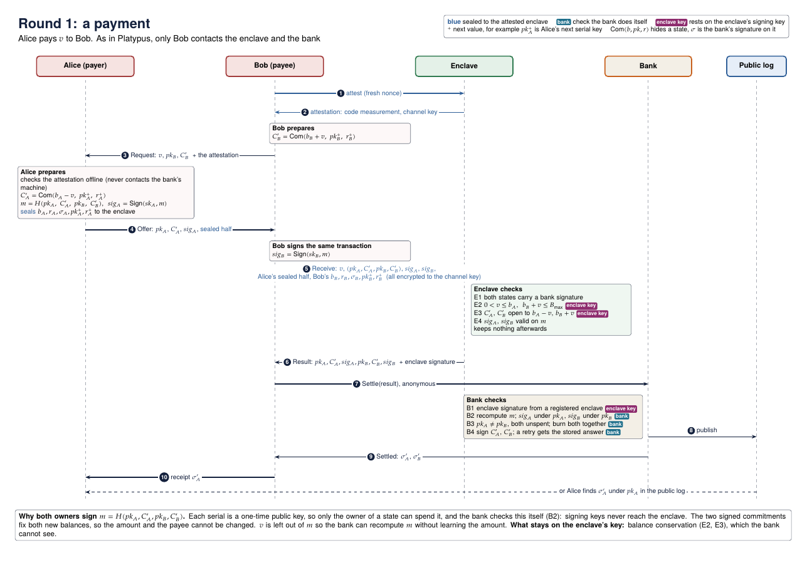
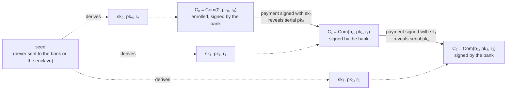
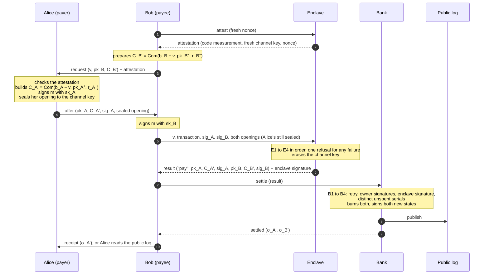
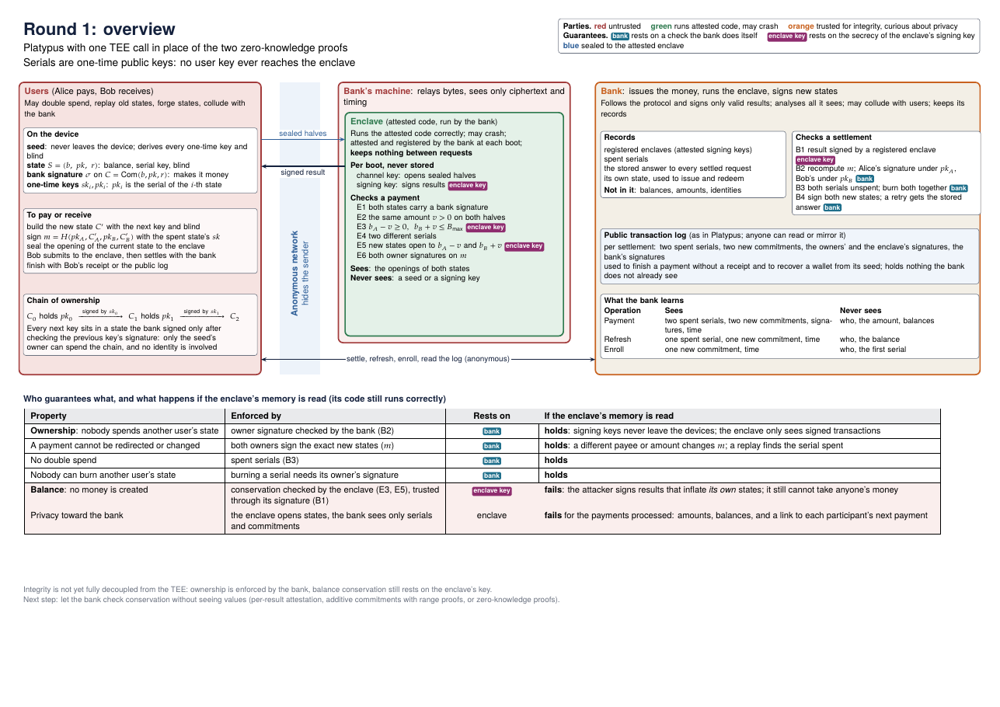

# Round 1: Platypus with a TEE in place of the zero-knowledge proofs

**Status:** submitted for advisor validation (2026-11-09). Builds on [SCOPE.md](../SCOPE.md) and [FOUNDATIONS.md](../FOUNDATIONS.md).

| Design | Behaviour | Analysis |
|---|---|---|
| [1. Goal](#1-goal-stay-as-close-to-platypus-as-possible) | [5. A payment](#5-a-payment) | [9. If the enclave's memory is read](#9-if-the-enclaves-memory-is-read) |
| [2. In one paragraph](#2-the-system-in-one-paragraph) | [6. Who checks what](#6-who-checks-what) | [10. What the bank learns](#10-what-the-bank-learns) |
| [3. Setting and trust](#3-setting-and-trust) | [7. Other operations](#7-other-operations) | [11. Possible solutions for balance](#11-possible-solutions-for-balance-integrity) |
| [4. State and ownership](#4-state-and-the-chain-of-ownership) | [8. Crashes](#8-when-the-enclave-crashes) | [Overview map](#overview-map) |
| [Appendix A: messages](#appendix-a-messages) | [Appendix B: notation](#appendix-b-notation) | [Appendix C: differences from Platypus](#appendix-c-differences-from-platypus) |

**TL;DR:** this diagram captures the main idea: one payment from Alice to Bob, checked by the enclave and settled by the bank.

The [payment map](maps/payment.pdf) and the [overview map](maps/overview.pdf) are also available as PDF.

## 1. Goal: stay as close to Platypus as possible

Round 1 keeps Platypus's base transaction (Platypus, Sections 3 and 7) and replaces its two zero-knowledge proofs with one call to a TEE run by the bank. Everything else changes only where that replacement or the foundation requires it, so the effect of the replacement can be measured ([Appendix C](#appendix-c-differences-from-platypus) lists every difference). Regulation (Platypus, Section 4) is left for later rounds.

> **One adjustment comes from the foundation: no user secret that can spend funds is ever sent to the enclave.** The version presented on 2026-11-03 gave the enclave the user's serial and blinding keys. Here each serial is a one-time public key and the owner signs each transaction, so the enclave only ever sees signed transactions.

**Result.** If the enclave's memory is read, the bank still enforces ownership, no double spend and no fund destruction, but the privacy of the requests read is lost and a leaked enclave key can create money (section 9). Crashes are handled by retries (section 8). Balance integrity is the open question (section 11).

## 2. The system in one paragraph

Each user holds a **state**: a balance, a one-time public key that serves as the serial, and a blind. The bank signs a commitment to it. To pay, the payer and the payee agree on one joint transaction, made of both spent serials and both new commitments, and each **signs it with the one-time key of the state they spend**. The payee sends the enclave the transaction, both signatures and both parties' openings, the payer's sealed so the payee cannot read it. The enclave checks that both states are genuine, that both owners signed and that the balances add up, then outputs a signed result. The payee sends the result to the bank. The bank checks the enclave's signature and **both owners' signatures**, burns the two serials, signs both new states, and publishes the transaction in the public log. While the enclave works, the bank never sees balances, amounts, or who pays whom in payments between users.

## 3. Setting and trust

| Party | Integrity | Privacy | Failure |
|---|---|---|---|
| **Bank** | trusted: follows the protocol and signs only valid results | honest-but-curious: analyses everything it sees and may collude with users; privacy is claimed for payments in which neither party colludes, as in Platypus (Definition 5.2) | does not lose its records |
| **TEE** (run by the bank) | runs the attested code correctly | protects what it processes | may crash; a fresh instance starts with empty memory |
| **Users** | untrusted: may double spend, replay old states or forge states | the protected party | may lose their device; keep a backup of their seed, as Platypus users back up their secret key |
| **Network** | none | attacks on network anonymity are out of scope, as in Platypus (Section 2.2); users may use an anonymity network | none |

**Assumptions:**
- As in Platypus (Section 3.2), the payer obtains the payee's public key over an authenticated channel; round 1 carries the payee's request over the channel built from it. How that key is obtained is out of scope.
- The hand-off between payer and payee is confidential, for privacy only. An eavesdropper would learn the amount and the two serials, which locate the payment in the public log. It could not change or redirect the payment (section 5).
- For the analysis of section 9, the enclave's memory may also be read while its code keeps running correctly. Replacing its code is out of scope.

## 4. State and the chain of ownership

A state is `S = (b, pk, r)`:
- `b` is the balance;
- `pk` is a one-time public key, which also serves as the serial. "One-time" means the key serves one state; the signature scheme itself is an ordinary (many-time) unforgeable scheme, so the same key may sign a payment and then a refresh;
- `r` is the commitment's blind. Without it, the commitment would not hide `b` once `pk` is revealed at spend: balances are few enough to try them all against the published commitment, which would reveal the balance and link the payment to the one that created the state.

The bank signs a commitment `C = Com(b, pk, r)` without learning its content. The commitment hides `S`, and the bank's signature `σ` makes it valid money. The bank's own states are signed with a separate issuance key, so the enclave can recognise them (section 7).

Each user keeps one secret seed, which **never reaches the bank or the enclave**; the user keeps a backup of it, as Platypus users back up their secret key. The `i`-th signing key and blind are derived from it, with separate labels. Spending the `i`-th state is signed with `sk_i` and creates a new state carrying `pk_{i+1}`.

**Why this proves ownership without proving identity.**
- The first state carries `pk_0`, chosen by the user at enrollment.
- Every later key `pk_{i+1}` sits inside a state that the bank signed only after verifying a signature by `sk_i`.
- By induction, only the holder of the seed can spend the chain.

To the bank, two keys from one chain are unrelated. In each payment, the enclave sees one link of each participant's chain (balance, current and next key, current and next blind) and keeps nothing after the request.

**Recovery.** The seed regenerates every key and blind. The user downloads the public log, or a mirror of it, and walks the chain locally, so nobody learns which entries it looks for. Unlike Platypus, whose log keeps only recent transactions, round 1's log keeps every entry so that the walk can start from `pk_0`. The balance of each new state is found by trying values against its commitment: at most `B_max` hash evaluations per link.

## 5. A payment

Alice pays `v` to Bob. As in Platypus, only the recipient talks to the system: Bob alone contacts the enclave and the bank.

To see the diagram in full screen, open it in [Mermaid Live](https://mermaid.live/view#pako:eNptVF1r3DAQ_CuLX-KjDk0ugUJoD-z0ni6UQl8NYS2vz-JsydXHhSPkv3cl-3KO0yfL2tXM7OxKr4nQNSUPkFj660kJ-ilxb7AvFQB6p5XvKzLhb0DjpJADKgc5oIW8k4IgHfBEZrXMKEJGoasxTp_i2xDfKtHhkZaxXTyL6rAMPIXAb18xMXR6H8LF9WazfQB0jqyDtDFkW1CaC4mU22uOF-c4OqkVpKFk6AmtN9STchmMx0SLSlEHBzplM4xf2hHoIxlgoMEQKyILj8_FFfyAR92n1XMBX-CYwXB4Lkq_vvmGGZjzcnWWmT-ACSYHnVNyFmFWfHom8CMnnxItiYMF19I87Xtlvm4qL7s6iMkvYnJg4vXtelKUXxRNy1U8auVeWejhRboWLOeNu4SdhZaJ9UBKqj04HZln5gSB-eirbhpOTQNNFlVkwLjhJwBRfUb5bOSSvph1k4U7g8qiCIVeIPnDllWaT0y4FtI4hlcWrJNdN9Eu6BhyexsK2d6DVKBNTSYDrYgb0niLHTTaAKoTNCg7nopoBRm0ZP9X_HmqeA58x90sEx7yMhntXvhwafNUQOg2jYMfTUDHhOfid2wMOdfxvRrBF5VwvIiVFPeB3hmeVP2iOPIOZbPP8FksqJbskRIOvLJsn2MqI7nd0yQZ7kfwNpt6E31W9AJh4MgGITuW-MSXIFxB2447oxWj6pq98Dd34i46MC15wD9cAUFycLPEFZdgptfEENaj5cPsmrOzSU-mR1mHp-q1TDijp5J_yqSmBtmoMnkLaeHN-nNSgkPOeOIdP9Qsf3rWpu23f5g_om0), or use the [payment map (PDF)](maps/payment.pdf).

1. **Request.** Bob attests the enclave with a fresh nonce and gets a channel key used for this payment only. He prepares his new state `C_B' = Com(b_B + v, pk_B⁺, r_B⁺)` and sends Alice the amount, his current serial `pk_B`, `C_B'` and the attestation. Alice never contacts the bank's machine.
2. **Offer.** Alice checks the attestation. She builds `C_A' = Com(b_A − v, pk_A⁺, r_A⁺)` and signs the transaction `m = H("pay", pk_A, C_A', pk_B, C_B')` with `sk_A`. She seals the opening of her current state, its bank signature, and her next key and blind to the channel key, so Bob cannot read them. She hands Bob the offer.
3. **Receive.** Bob signs the same `m` with `sk_B`. He sends the enclave the amount `v`, the transaction, both signatures, Alice's sealed opening and his own opening, encrypted to the channel key, so the bank's machine sees only ciphertext.
4. **Check.** The enclave runs the checks of section 6, returns one signed result, and erases the channel key.
5. **Settle.** Bob submits the result. The bank runs its checks, burns both serials together, signs both new states, and appends the transaction to the public log. Bob counts the payment as received only once it is settled.
6. **Finish.** Bob forwards Alice's new signature. If he does not, Alice finds it in the public log under her old serial.

**The amount never appears in `m`.** The bank must be able to recompute `m` without learning `v`. That is not a loss: `C_A'` commits to `b_A − v` and `C_B'` to `b_B + v`, so the two signed commitments fix the amount, and the enclave checks it by opening both.

## 6. Who checks what

**The enclave** opens both states and runs the checks in this order. Any failure returns the same refusal, so a wrong `v` fails at E2 before the balance is ever compared, and Bob learns nothing about Alice's balance by retrying.

| # | Check | Prevents | Rests on |
|---|---|---|---|
| E1 | both openings give commitments that contain the revealed serials `pk_A`, `pk_B` and carry a valid bank signature (or the bank's issuance key, for the bank's own states) | spending a state the bank never issued | enclave key |
| E2 | the new commitments open to `b_A − v` and `b_B + v` with the new keys and blinds | new states that do not match the amount | enclave key |
| E3 | both owner signatures on `m` | someone else spending a state | bank (B2 repeats it) |
| E4 | `0 < v ≤ b_A` and `b_B + v ≤ B_max`, unless Bob's state is the bank's own | overspending, overflow | enclave key |

**The bank** sees only serials, commitments and signatures:

| # | Check | Prevents | Rests on |
|---|---|---|---|
| B1 | it recomputes `m`; if that transaction was already settled, it returns the stored answer and stops | a lost or doubled payment after a crash | bank |
| B2 | it verifies Alice's signature on `m` under `pk_A` and Bob's under `pk_B` | theft, even if the enclave's memory is read | bank |
| B3 | the result is signed by a registered enclave | results not checked by the attested code | enclave key |
| B4 | the two serials differ and neither was spent; it burns both, signs both new commitments and publishes the transaction | double spending, and spending one state on both sides | bank |

## 7. Other operations

Enroll and refresh go through the enclave and the bank like a payment, with their inputs encrypted to the channel key of a fresh attestation. Issue and redeem use ordinary payments. Reading the log needs neither.

| Operation | What happens | What the bank learns |
|---|---|---|
| **Enroll** | The user opens a first state `Com(0, pk_0, r_0)` to the enclave, which checks that the balance is 0. The bank signs it. | one new commitment |
| **Refresh** (abort) | Platypus's empty update. The owner signs `H("refresh", pk, C')` with `sk`. The enclave checks E1, the signature, and that `C'` holds the same balance. The bank applies B1 to B4 to the one state: stored answer for a retry, the owner's signature under `pk`, a registered enclave's signature, `pk` unspent; it then burns `pk`, signs `C'` and publishes the result. It cancels an offer that was never settled. A party whose serial was shown to the counterparty in a payment that did not complete refreshes too, so no exposed serial stays in use. | one spent serial, one new commitment |
| **Issue** | As in Platypus (Section 7), the bank signs a state for its own account and pays users from it with ordinary payments. Round 1 adds two things: the bank signs its own states with its issuance key and logs the issued amount, and the enclave exempts a side whose state carries the issuance key from `B_max` (E1, E4). | its own side, the amount, and the recipient's serial `pk_B` (and the recipient, whose request it receives) |
| **Redeem** (not in Platypus) | A payment to the bank's state. | its own side, the amount, and the payer's serial; whether it learns the user depends on how the request reaches it |
| **Read the public log** | Anyone can download it or mirror it. A user finds the bank's signature on a new state under the old serial. | nothing, when the whole log is downloaded |

## 8. When the enclave crashes

The enclave keeps no payment state between requests, so a crash loses nothing:
- **Before the enclave returns a result:** nothing happened. Bob attests a fresh instance and relays the new attestation; Alice, who must be online, reseals the same content to the new channel key. Her signature does not change, because `m` names no enclave.
- **After the result, before settlement:** Bob settles the result he already holds. The bank keeps the old instance's registered key valid long enough to accept it.
- **After the bank records it:** a retry of the same transaction gets the stored answer (B1). There is never a second debit.
- **Deterministic results:** every new key and blind comes from the users, so the same input always gives the same transaction.
- **Replays:** an exact replay of a settled transaction gets the stored answer (B1); any other transaction spending that serial is refused (B4).
- **Total outage:** the bank's records, the users' states and the public log are enough to restart. A new enclave is attested and registered.

**Privacy across a crash.** The bank additionally learns only timing: that a payment was retried, or that a result signed by the previous instance was in flight at the crash. Everything else in section 10 holds.

## 9. If the enclave's memory is read

Suppose an attacker can read everything the enclave holds or receives: the openings of the states, the channel keys of the requests in progress, and the enclave's signing key. The code itself still runs correctly.

| Property | Holds? | Why |
|---|---|---|
| **Ownership:** nobody spends someone else's state | **yes** | Spending needs the owner's signature (B2). Signing keys never leave the devices; the enclave only sees signed transactions. |
| A payment cannot be redirected or changed | **yes** | The owners sign the exact new states (`m`). An exact replay gets the stored answer (B1); anything else spending the serial is refused (B4). |
| No double spend | **yes** | The bank's spent set (B4). |
| Nobody can burn another user's state | **yes** | Burning a serial needs its owner's signature. |
| **Balance:** no money created | **no** | The bank cannot see balances, so E1, E2 and E4 are checked only by the enclave. With its signing key, an attacker signs results for states that never existed, with any balance, and can then redeem them at the bank. It still cannot take anyone's existing state. |
| Privacy toward the bank | **no**, for the requests read | For each payment it reads, the attacker learns the amount and both balances, and links it to the previous and the next payment of both participants, revealing the balances those payments left. An enroll it reads reveals `pk_0`, linking it to the user's first payment; a refresh reveals the balance and the next serial. Each channel key serves one request and is then erased, so requests not read during the break stay private. |

## 10. What the bank learns

While the enclave works, and with recovery done by downloading the whole log:

| Operation | Sees | Never sees |
|---|---|---|
| Payment | two spent serials (and which one paid), two new commitments, three signatures, the time | who pays or receives, the amount, any balance, the next serials |
| Refresh | one spent serial, one new commitment, the time | who, the balance |
| Enroll | one new commitment, the time | who, the first serial |
| Issue | its own side, the amount, the recipient's serial `pk_B` and new commitment, and who the recipient is | the recipient's balance |
| Redeem | its own side, the amount, the payer's serial and new commitment | the payer's balance; who the payer is, unless the request reveals it |

Each serial is a fresh key used once, so the bank cannot link two payments by the same user.

## 11. Possible solutions for balance integrity

**The goal:** the bank checks balance conservation itself, as it already checks ownership, while keeping Platypus's privacy. Without a cryptographic proof, the bank can only take a TEE's word on balances. The options either add a proof, or move that trust from the enclave's own key to the hardware vendor. For discussion:

| Option | Balance rests on | The bank sees who pays whom | Amounts hidden | Role of the TEE | Cost |
|---|---|---|---|---|---|
| **Zero-knowledge proofs as in Platypus** | mathematics plus a trusted setup, or mathematics alone with a transparent proof system | no | yes | computes the proofs for weak devices, only for a variant whose witness holds no long-term spending key (Platypus's witness holds one); a break leaks what it saw | one proof per party per payment |
| **Public accounts with additive commitments and range proofs** | mathematics | yes | yes | not needed for integrity | small proofs, cheap checks |
| **The same, with the TEE batching payments** | mathematics | only which batch | yes | hides who pays whom inside a batch; a break reveals that pairing | batch rounds, all participants online |
| **The enclave attests every result** | the hardware vendor and correct code: the vendor's attestation key is not in enclave memory, so reading the memory is not enough to forge a result | no | yes | as in round 1 | one attestation per payment |

## Overview map

## Appendix A: messages

| Message | From → to | Content |
|---|---|---|
| Attest | Bob → enclave | a fresh nonce |
| Attestation | enclave → Bob → Alice | code measurement, a fresh channel key for this payment, Bob's nonce. The enclave's signing key is registered with the bank separately, at boot. |
| Request | Bob → Alice | `v`, `pk_B`, `C_B'` |
| Offer | Alice → Bob | `pk_A`, `C_A'`, `sig_A = Sign(sk_A, m)`, sealed opening = `Enc(channel key, b_A, r_A, σ_A, pk_A⁺, r_A⁺)` |
| Receive | Bob → enclave, encrypted to the channel key | `v`, the transaction `(pk_A, C_A', pk_B, C_B')`, `sig_A`, `sig_B`, Alice's sealed opening, and Bob's opening `b_B, r_B, σ_B, pk_B⁺, r_B⁺` |
| Result | enclave → Bob | `"pay"`, `pk_A, C_A', sig_A, pk_B, C_B', sig_B`, signed by the enclave |
| Settle / Settled | Bob ↔ bank | the result / the bank's signatures `σ_A'`, `σ_B'` on the new states |
| Receipt | Bob → Alice | `σ_A'` |
| Public log entry | bank → anyone | every settled payment or refresh result, with the bank's signatures |
| Enroll | user → enclave → bank | `(0, pk_0, r_0)`, encrypted to the channel key of a fresh attestation; result `"enroll", C_0`, signed by the enclave; the bank returns `σ_0` |
| Refresh | user → enclave → bank | the opening `(b, r)`, `σ`, next key and blind, encrypted to the channel key of a fresh attestation; the transaction `(pk, C')` and `sig = Sign(sk, H("refresh", pk, C'))`; result `"refresh", pk, C', sig`, signed by the enclave; the bank returns `σ'` |

## Appendix B: notation

| Symbol | Meaning |
|---|---|
| `S = (b, pk, r)` | a state: balance, one-time public key (the serial), blind |
| `Com(b, pk, r)` | hiding, binding commitment to a state |
| `C`, `C'` | the commitment of a current or new state |
| `σ`, `σ'` | the bank's signature on a current or new commitment; the bank's own states use a separate issuance key |
| opening | the values `(b, r)` that open a commitment; in a payment, each party also sends `σ` and its next key and blind |
| `v` | the amount of a payment |
| `sk_i, pk_i` | the `i`-th key pair, used for one state only; `pk_i` is the serial; the signature scheme is an ordinary unforgeable one |
| seed | the user's only secret, backed up by the user; `sk_i` and `r_i` are derived from it with separate labels |
| `⁺` | the value for the next state (for example `pk_A⁺ = pk_{A,i+1}`) |
| `H` | a collision-resistant hash, with a label for each kind of message |
| `m` | the transaction both owners sign: `H("pay", pk_A, C_A', pk_B, C_B')` |
| `Sign`, `sig` | an owner's signature with a one-time key |
| `Enc(channel key, …)` | encryption to the channel key of an attested enclave |
| `B_max` | the maximum balance of a user's state |

## Appendix C: differences from Platypus

| | Platypus | Round 1 |
|---|---|---|
| Validity of a transaction | two zero-knowledge proofs, one per party, bound by a transaction commitment | one enclave check of the whole transaction, and one signed result |
| Serial | a pseudorandom chain derived from a long-term key | a one-time public key derived from the seed |
| Ownership of a state | proven inside the zero-knowledge proof | the owner signs with the serial's one-time key, and the bank verifies it |
| Binding the two sides | the transaction commitment; the payer starts | both owners sign `m`; the payee starts with a request, so the payer learns the payee's serial before settlement |
| Payer's private data | hidden inside her proof | sealed to the attested enclave, so the payee cannot read it |
| Balance conservation | guaranteed by the proofs: mathematics plus a trusted setup run by the bank (Platypus, Section 3) | guaranteed by the enclave's checks and its key |
| Abort | the payer's empty update | either party's refresh, checked by the enclave |
| Extra pieces needed by the TEE | none | attestation and enclave registration, resealing after a crash, uniform refusals, idempotent settlement |
| Public log | recent transactions only | every entry, so recovery can walk the chain from `pk_0` |
| User-held state, spent-serial check, issuance | as in the paper | the same (issuance adds an issuance key, section 7) |
